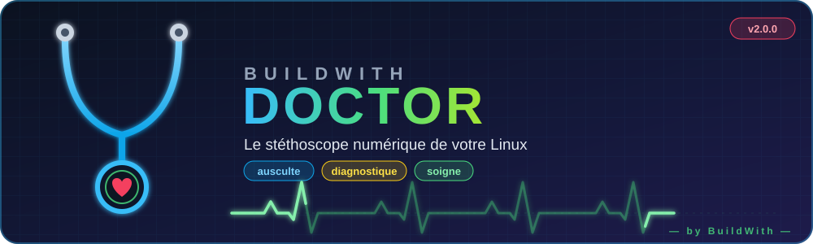
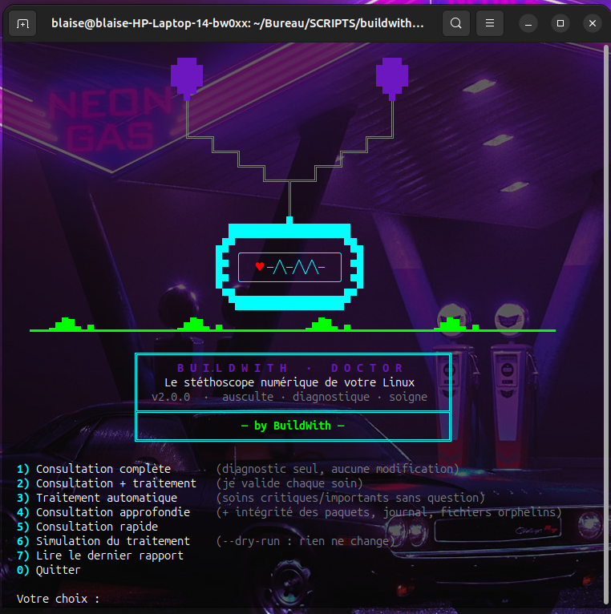
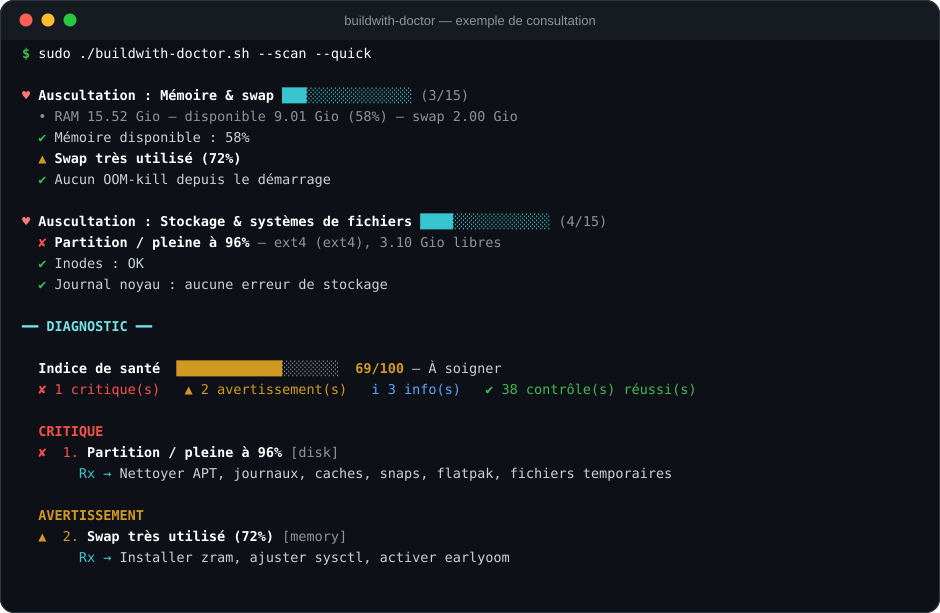

<div align="center">



<br/>


### Auscultation · Diagnostic · Ordonnance · Traitement · Contre-visite

**Un seul script Bash qui examine la santé de votre machine Linux, vous dit ce qui ne va pas, et la soigne, avec votre accord.**

[Démarrage rapide](#démarrage-rapide) ·
[Utilisation](#utilisation) ·
[Modules](#les-15-modules-dauscultation) ·
[Soins](#le-carnet-de-soins) ·
[Garde-fous](#garde-fous)

</div>

---

## Sommaire

1. [Aperçu](#aperçu)
2. [Comment ça marche](#comment-ça-marche)
3. [Démarrage rapide](#démarrage-rapide)
4. [Utilisation](#utilisation)
5. [Les 15 modules d'auscultation](#les-15-modules-dauscultation)
6. [L'indice de santé](#lindice-de-santé)
7. [Le carnet de soins](#le-carnet-de-soins)
8. [Garde-fous](#garde-fous)
9. [Fichiers générés](#fichiers-générés)
10. [Codes de sortie](#codes-de-sortie)
11. [Automatisation (cron, CI)](#automatisation-cron-ci)
12. [Compatibilité](#compatibilité)
13. [Questions fréquentes](#questions-fréquentes)

---

## Aperçu

Au lancement, BuildWith Doctor affiche son écran d'accueil (stéthoscope, électrocardiogramme et signature), puis le menu interactif :

<div align="center">

<br/>
<sub>Écran d'accueil et menu interactif, capturés sur Ubuntu (GNOME Terminal).</sub>
</div>

<br/>

Une consultation affiche ensuite le résultat de chaque module, puis un diagnostic chiffré :

<div align="center">

<br/>
<sub>Exemple de consultation (<code>--scan --quick</code>) : les modules défilent, puis le diagnostic classe les anomalies et propose un soin pour chacune.</sub>
</div>

**Les couleurs ont un sens :**

| Couleur | Signification |
|:--|:--|
|  | Contrôle réussi |
|  | Avertissement |
|  | Anomalie critique |
|  | Information |
| -06b6d4?style=flat-square) | Le soin proposé pour une anomalie |

---

## Comment ça marche


| Étape | Ce qui se passe | Modifie le système ? |
|:--|:--|:-:|
| **Auscultation** | Chaque module lit l'état de la machine (`/proc`, `/sys`, journaux, paquets…) | Non |
| **Diagnostic** | Les anomalies sont classées par gravité et un indice de santé est calculé | Non |
| **Ordonnance** | Chaque anomalie réparable reçoit un soin (`Rx →`) | Non |
| **Traitement** | Les soins sont appliqués un à un, après votre accord | **Oui** |
| **Contre-visite** | Nouvelle auscultation silencieuse : score avant puis après | Non |

---

## Démarrage rapide

```bash
# 1. Rendre le script exécutable
chmod +x buildwith-doctor.sh

# 2. Lancer le menu interactif
sudo ./buildwith-doctor.sh
```

Un premier coup d'œil **sans rien modifier** :

```bash
sudo ./buildwith-doctor.sh --scan
```

Voir ce que le traitement ferait, **sans l'appliquer** :

```bash
sudo ./buildwith-doctor.sh --heal --dry-run
```

> **Sans `sudo` ?** Si vous lancez une action sans être root, le script se relance tout seul avec `sudo`. Si `sudo` n'est pas disponible, il fait un diagnostic partiel.

---

## Utilisation

### Le menu interactif

Lancé sans option dans un terminal, le script affiche ce menu (voir la capture plus haut) :

| Choix | Mode | En clair |
|:-:|:--|:--|
| `1` | Consultation complète | Diagnostic seul, **aucune modification** |
| `2` | Consultation + traitement | Vous validez **chaque soin** |
| `3` | Traitement automatique | Soins critiques et importants sans question |
| `4` | Consultation approfondie | Ajoute l'intégrité des paquets, du journal et les fichiers orphelins |
| `5` | Consultation rapide | Saute les contrôles lents |
| `6` | Simulation du traitement | `--dry-run` : rien ne change |
| `7` | Lire le dernier rapport | Ouvre `dernier-rapport.txt` |
| `0` | Quitter | |

### Les options

#### Actions

| Option | Effet |
|:--|:--|
| *(aucune)* | Menu interactif (ou `--scan` si le script n'est pas lancé dans un terminal) |
| `--scan` <sub>(`--status`, `--check`)</sub> | Diagnostic complet, **aucune modification** |
| `--heal` <sub>(`--fix`, `--repair`)</sub> | Diagnostic et traitement, confirmation pour chaque soin |
| `--auto` | Équivaut à `--heal --yes` |

#### Réglages

| Option | Effet |
|:--|:--|
| `--deep` | Auscultation approfondie : `dpkg --verify`, `journalctl --verify`, fichiers sans propriétaire |
| `--quick` | Saute les contrôles lents (intégrité, fichiers world-writable, détail des gros dossiers) |
| `--dry-run` | Simule les traitements, **rien n'est modifié** |
| `--yes`, `-y` | Répond « oui » aux soins critiques et importants |
| `--full` | Avec `--yes` : inclut aussi les soins **optionnels** (niveau information) |
| `--only a,b` | N'ausculte que ces modules |
| `--skip a,b` | Ignore ces modules |
| `--list` | Liste les modules disponibles |
| `--no-reboot` | Ne propose jamais de redémarrage |
| `--no-anim` | Désactive les animations |
| `--no-color` | Désactive les couleurs (la variable `NO_COLOR` est aussi respectée) |
| `-v`, `--version` | Affiche la version |
| `-h`, `--help` | Affiche l'aide |

### Recettes

```bash
# Contrôle de routine, rapide
sudo ./buildwith-doctor.sh --scan --quick

# Examen complet et approfondi
sudo ./buildwith-doctor.sh --scan --deep

# Ne regarder que la mémoire et le disque
sudo ./buildwith-doctor.sh --scan --only memory,disk

# Tout sauf les conteneurs et l'intégrité
sudo ./buildwith-doctor.sh --scan --skip containers,integrity

# Soigner en validant chaque soin
sudo ./buildwith-doctor.sh --heal

# Soigner sans poser de question, soins optionnels compris
sudo ./buildwith-doctor.sh --auto --full --no-reboot
```

---

## Les 15 modules d'auscultation

Utilisez l'identifiant avec `--only` ou `--skip`.

| # | Identifiant | Ce qui est examiné |
|:-:|:--|:--|
| 1 | `system` | Distribution, noyau, uptime, noyau « tainted », UEFI ou BIOS, `machine-id` |
| 2 | `cpu` | Charge par cœur, utilisation instantanée, attente disque (iowait), processus les plus gourmands |
| 3 | `memory` | RAM disponible, swap, mémoire slab du noyau, OOM-kills, protection anti-saturation |
| 4 | `disk` | Espace et inodes, systèmes de fichiers en lecture seule, `fstab`, erreurs d'E/S, RAID, SMART, TRIM |
| 5 | `services` | État de systemd, unités en échec, redémarrages en boucle, temps de démarrage |
| 6 | `packages` | Base de paquets cassée, mises à jour (dont sécurité), orphelins, anciens noyaux, snaps |
| 7 | `security` | UID 0, comptes sans mot de passe, permissions sensibles, `/tmp`, setuid, SSH, pare-feu, ASLR |
| 8 | `network` | Passerelle, Internet, DNS, nom d'hôte, synchronisation NTP, erreurs d'interface, rfkill |
| 9 | `logs` | Erreurs du journal, segfaults, traces noyau, erreurs MCE, firmware manquant, taille de `/var/log` |
| 10 | `hardware` | Températures, bridage thermique, santé de la batterie, outils de diagnostic |
| 11 | `processes` | Zombies, processus bloqués (état D), descripteurs de fichiers, threads |
| 12 | `users` | Syntaxe de `sudoers`, UID dupliqués, cohérence `passwd` et `group`, dossiers personnels |
| 13 | `boot` | `initramfs`, chargeur de démarrage, partition EFI, noyau plus récent installé |
| 14 | `containers` | Docker : espace récupérable, conteneurs arrêtés |
| 15 | `integrity` | Liens cassés ; avec `--deep` : `dpkg --verify`, journal systemd, fichiers orphelins |

```bash
sudo ./buildwith-doctor.sh --list
```

---

## L'indice de santé

Chaque consultation aboutit à une note sur **100** :

```text
score = 100 - (12 x critiques) - (4 x avertissements) - (1 x informations)
```

> **Plafond :** dès qu'il y a **au moins une anomalie critique**, le score ne peut pas dépasser **69**.

| Score | État | Couleur |
|:-:|:--|:--|
| **90 à 100** | Excellente santé |  |
| **75 à 89** | Bonne santé |  |
| **50 à 74** | À soigner |  |
| **0 à 49** | État préoccupant |  |

### Les trois niveaux de gravité

| Niveau | Poids | Signification |
|:--|:-:|:--|
|  | -12 | Panne ou risque sérieux : disque plein, RAM saturée, compte sans mot de passe… |
|  | -4 | À corriger bientôt : mises à jour de sécurité, pare-feu absent, swap très utilisé… |
|  | -1 | Amélioration conseillée : paquets orphelins, TRIM, anciens noyaux… |

---

## Le carnet de soins

Chaque anomalie réparable est associée à un soin. Le traitement les passe **par ordre de gravité** (critiques d'abord) et ne propose chaque soin **qu'une seule fois**.

| Soin | Ce qu'il fait |
|:--|:--|
| **Libérer la mémoire** | Vide les caches noyau, compacte la mémoire, purge le swap disque **seulement s'il reste assez de RAM libre** |
| **Durcir la mémoire** | Installe zram (swap compressé), crée un swap de secours si possible, règle `sysctl`, active earlyoom |
| **Nettoyer le disque** | `apt clean` et `autoremove`, journaux systemd (7 jours / 200 Mo), vieux logs, core dumps, fichiers temporaires de plus de 10 jours, miniatures, snaps, Flatpak, Docker |
| **TRIM** | Active `fstrim.timer` et lance un TRIM sur les SSD |
| **Services en échec** | `reset-failed` puis redémarrage, avec vérification de stabilité et dernières lignes de journal en cas d'échec |
| **Réparer APT** | `dpkg --configure -a` puis `apt-get install -f` |
| **Mises à jour** | `apt`, `dnf` ou `pacman` selon la distribution |
| **Orphelins et configurations résiduelles** | `autoremove --purge`, purge des paquets à l'état « rc » |
| **Verrouiller les comptes vides** | `passwd -l` sur les comptes sans mot de passe |
| **Permissions** | Rétablit des modes sûrs (`shadow`, `sudoers`, clés SSH, `~/.ssh`…) |
| **`/tmp` et setuid** | `chmod 1777 /tmp /var/tmp`, retire les bits setuid et setgid des fichiers temporaires |
| **Durcir SSH** | `PermitRootLogin` passe à `prohibit-password`, `PermitEmptyPasswords` à `no`, **validé par `sshd -t`** |
| **Pare-feu** | Installe et active ufw : entrant refusé, sortant autorisé, SSH et services en écoute autorisés |
| **Réseau, DNS, hosts, NTP** | Redémarre le gestionnaire réseau, répare `resolv.conf`, ajoute le nom d'hôte à `/etc/hosts`, active NTP |
| **Zombies** | Envoie `SIGCHLD` aux parents pour qu'ils récoltent leurs processus zombies |
| **Démarrage** | Régénère l'initramfs, monte la partition EFI (`mount -a`) |
| **Docker** | Supprime les images *dangling* et le cache de build de plus de 7 jours |
| **Réinstaller des paquets altérés** | Réinstalle les paquets dont des binaires diffèrent de l'original (avec `--deep`) |

### Quand le script demande-t-il votre avis ?

| Mode | Soins critiques et avertissements | Soins optionnels (information) |
|:--|:-:|:-:|
| `--heal` | Confirmation pour chacun | Confirmation pour chacun |
| `--auto` ou `--yes` | Appliqués sans question | **Ignorés** |
| `--auto --full` | Appliqués | Appliqués |
| `--dry-run` | Simulés | Simulés |

> Même avec `--yes`, la suppression de **toutes** les images Docker inutilisées n'est **jamais** faite automatiquement : elle exige une confirmation explicite.

---

## Garde-fous

<table>
<tr>
<td width="50%" valign="top">

### Rien n'est modifié sans filet
Avant d'éditer un fichier, le script en fait une **copie** dans  
`/var/backups/buildwith-doctor/<date>/`

### Mode simulation
`--dry-run` affiche chaque action précédée de `[simulation]` et ne touche à rien.

### Verrou anti-doublon
Une seule instance à la fois (`flock`) : impossible de lancer deux traitements en parallèle.

</td>
<td width="50%" valign="top">

### Retour arrière automatique
La configuration SSH est **testée** (`sshd -t`) ; en cas d'échec, les fichiers d'origine sont **restaurés**.

### Précautions intégrées
- Le swap n'est purgé que si la RAM peut l'absorber
- Le pare-feu autorise SSH avant de s'activer
- Les ports de bases de données (3306, 5432, 6379…) ne sont **pas** ouverts automatiquement
- Aucun redémarrage automatique avec `--yes`

### Interruption propre
`Ctrl+C` arrête proprement le script et restaure le curseur.

</td>
</tr>
</table>

> **À savoir :** `--auto` applique de **vraies modifications** (mises à jour, pare-feu, durcissement SSH, zram…). Lancez d'abord `--heal --dry-run` pour voir ce qui serait fait.

---

## Fichiers générés

```text
/var/log/buildwith-doctor/
├── rapport-20261125-143012.txt      rapport lisible
├── rapport-20261125-143012.json     même rapport, pour les machines
├── actions-20261125-143012.log      journal détaillé des actions
├── dernier-rapport.txt              lien vers le dernier rapport
└── dernier-rapport.json

/var/backups/buildwith-doctor/
└── 20261125-143012/                 copies des fichiers modifiés
    └── etc/ssh/sshd_config
```

> Sans droits root, les journaux sont écrits dans `~/.local/state/buildwith-doctor/`.

<details>
<summary><b>Aperçu du rapport JSON</b> (cliquer pour déplier)</summary>

```json
{
  "tool": "BuildWith Doctor", "version": "2.0.0", "signature": "by BuildWith",
  "date": "2026-11-25T14:30:12+01:00", "host": "mon-serveur", "kernel": "6.8.0",
  "score": 69, "critical": 1, "warnings": 2, "info": 3, "passed": 38,
  "findings": [
    {
      "severity": "crit",
      "module": "disk",
      "title": "Partition / pleine à 96%",
      "detail": "ext4 (ext4), 3.10 Gio libres",
      "fix": "Nettoyer APT, journaux, caches, snaps, flatpak, anciens fichiers temporaires"
    }
  ]
}
```

</details>

---

## Codes de sortie

| Code | Signification |
|:-:|:--|
| `0` | **En bonne santé** : aucun avertissement ni anomalie critique |
| `1` | **Avertissements** détectés |
| `2` | **Anomalie critique** détectée (ou option ou module invalide) |

---

## Automatisation (cron, CI)

Hors terminal, le script passe automatiquement en mode `--scan`. Combiné aux codes de sortie et au rapport JSON, il s'intègre facilement à la supervision.

```bash
# Contrôle quotidien à 6 h, sans couleurs ni animations
0 6 * * *  /opt/buildwith-doctor.sh --scan --quick --no-color >/dev/null 2>&1
```

```bash
# Réagir selon l'état
sudo ./buildwith-doctor.sh --scan --quick --no-color
case $? in
  0) echo "Machine en bonne santé" ;;
  1) echo "Avertissements : voir le rapport" ;;
  2) echo "Critique : intervention nécessaire" ;;
esac

# Lire le score depuis le JSON
jq '.score' /var/log/buildwith-doctor/dernier-rapport.json
```

---

## Compatibilité

| Élément | Détail |
|:--|:--|
| **Shell** | Bash 4 ou supérieur obligatoire (tableaux associatifs) |
| **Droits** | root conseillé ; le script se relance via `sudo` si besoin |
| **Init** | systemd recommandé (module `services` ignoré sinon) |
| **Gestionnaires de paquets** | `apt` : complet · `dnf` et `pacman` : partiel |
| **Conteneurs et machines virtuelles** | Détectés ; les contrôles matériels sont adaptés |

> **Outils optionnels :** `smartmontools` (SMART), `lm-sensors`, `ufw`, `earlyoom`. Sur Debian et Ubuntu, un soin dédié peut installer les deux premiers.

---

## Questions fréquentes

<details>
<summary><b>Le mode <code>--scan</code> modifie-t-il quelque chose ?</b></summary>

Non. Il ne lit que l'état du système et n'écrit que ses propres rapports et journaux.

</details>

<details>
<summary><b>Puis-je annuler un soin ?</b></summary>

Les fichiers de configuration modifiés sont sauvegardés dans `/var/backups/buildwith-doctor/<date>/` ; vous pouvez les recopier à leur emplacement d'origine. Les actions sans fichier (mises à jour, nettoyages) ne sont pas réversibles : utilisez `--dry-run` avant.

</details>

<details>
<summary><b>Pourquoi un redémarrage est-il parfois recommandé ?</b></summary>

Quand des mises à jour du noyau ou de bibliothèques sont installées mais pas encore actives, ou en cas de fuite mémoire noyau probable. Avec `--yes`, le script ne redémarre jamais tout seul.

</details>

<details>
<summary><b>Je n'ai pas Debian ni Ubuntu, est-ce que ça marche ?</b></summary>

Oui pour le diagnostic général. Les contrôles et soins liés aux paquets sont les plus complets avec `apt` ; ils sont plus limités avec `dnf` et `pacman`.

</details>

<details>
<summary><b>Les couleurs s'affichent mal.</b></summary>

Utilisez `--no-color` ou définissez `NO_COLOR=1`. Elles sont aussi désactivées automatiquement hors terminal.

</details>

---

<div align="center">

**Gardez votre Linux en pleine forme.**

<sub>BuildWith Doctor v2.0.0 · by BuildWith</sub>

</div>
